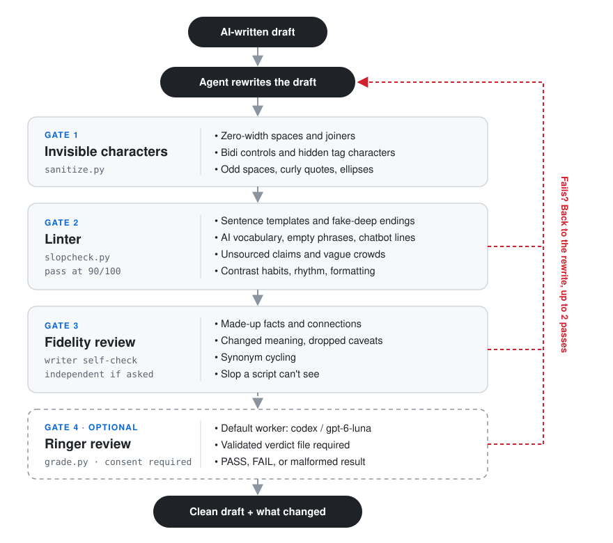

# anti-ai-slop

A skill for Claude Code, Codex, and other coding agents that removes AI-writing tells
from a draft and then checks the result before handing it back.

<p align="center">
  
</p>

## What it catches

### Sentence patterns

1. **Negative parallelism.** "It isn't a pricing problem. It's a trust problem."
2. **Throat-clearing openers.** "Here's the thing," "Let me be honest"
3. **Faux-insight setups.** "What most teams get wrong," "The part nobody mentions"
4. **Rhetorical setups.** "Think about it:" "Sound familiar?"
5. **Colon reveals.** "The clever part: it retries on its own."
6. **Trailing -ing analysis.** "...adds dark mode, underscoring its focus on users"
7. **Importance puffery.** "stands as a testament to," "cannot be overstated"
8. **Telling the reader what to think.** "As you can see," "The key takeaway here is"
9. **Fake-strong verbs.** "serves as a unified layer," "has the ability to"
10. **False agency.** "The consensus emerged." "The data tells us"
11. **Dramatic fragments.** "That's it. That's the product."
12. **Fake-profound endings.** "And we're just getting started."
13. **Recap endings.** "In conclusion," "To sum up"
14. **Vague declaratives.** "The stakes are high." "The implications are significant."
15. **Stacked hedges.** "could potentially," "it might be argued that"
16. **Half-and-half framing.** "Pricing is half the story. The other half is..."
17. **Stiff wording.** "only when the cheaper option will not do"

### Habits that only show up in bulk

18. **Contrast on every claim.** "a settings change rather than a code change,"
    "instead of waiting." One is fine. Three in a short post gets flagged.
19. **Too many rhetorical questions** that the post answers itself

### Words and phrases

20. **AI vocabulary.** "delve," "leverage," "seamless," "tapestry," and about 120 more
21. **Empty phrases.** "at its core," "in today's fast-paced world," and about 100 more
22. **Canned openers.** "Moreover," "Ultimately," "In essence"
23. **Chatbot leftovers.** "Great question," "Hope this helps," "feel free to"
24. **Unsourced claims.** "studies show," "experts agree"
25. **Vague crowds.** "most companies," "we all know"
26. **Filler words.** "truly," "basically," "incredibly"
27. **Sweeping words.** "everyone," "nobody," "always"

### Rhythm and formatting

28. **Same-length sentences** four times in a row
29. **Short punchy sentences** stacked four deep
30. **Em dashes** everywhere
31. **Emoji used as headings or bullets**
32. **Lists of three** used for rhythm, over and over
33. **Adjective stacks.** "powerful and intuitive"
34. **Random bold** in the middle of sentences
35. **Headings over one or two sentences**
36. **Title Case Headings**
37. **Invisible characters** like zero-width spaces

### Things only a second reviewer catches

38. **Made-up facts.** A number, source, or quote the original never had
39. **Made-up connections.** A time frame, a cause, or a reaction added while smoothing
    a sentence, like "over several quarters" or "the feature customers ask about most"
40. **Synonym cycling.** "The agent reviews the draft. The assistant scores it. The
    tool suggests fixes."
41. **Changed meaning.** A dropped caveat, a claim made stronger than the original, or
    an argument that stops making sense after the cuts

## How it works

You give your agent a draft. It rewrites it, and then the draft has to get through
four gates before you see it:

1. **Gate 1: invisible characters.** Removes zero-width spaces, hidden tag characters,
   bidi controls, and odd spacing that come along with pasted AI text. Emoji and
   non-Latin text are left alone.
2. **Gate 2: the linter.** A Python script scores the draft out of 100 against
   everything in the list above that a script can find. That covers sentence templates,
   AI vocabulary, empty phrases, chatbot leftovers, unsourced claims, contrast habits,
   rhythm, and formatting. It skips code and quotes, gives the same score every time,
   and needs 90 with no serious findings.
3. **Gate 3: a fidelity self-check.** Compare the original and rewrite for made-up
   facts, changed meaning, dropped caveats, and unsupported verification claims.
   Ask for an independent reviewer only when you want one.
4. **Gate 4, optional: another model.** An independent review through a locally
   installed Ringer CLI. It defaults to `codex:gpt-6-luna`, requires explicit
   consent, and calculates no authorship score.

If a check fails, fix it and verify again. List unresolved issues clearly.

Treat linter findings as leads, not proof. It can flag useful technical terms,
invariants, and necessary contrasts. Meaning, names, quantities, and qualifiers
take priority; justify retained findings with a written suppression reason.

For co-written or user-authored technical work, default to the minimum effective
edit and preserve voice and caveats. Do not target a word-count reduction. Comments
need one self-check, PRs need meaning, verification, and risk checks, and long
reports get at most two passes. Independent review is optional and requires consent.

## Install

For Claude Code:

```bash
git clone https://github.com/misbahsy/anti-ai-slop.git
cp -r anti-ai-slop/skills/anti-ai-slop ~/.claude/skills/
```

For other agents, copy `skills/anti-ai-slop` into whatever folder your agent loads
skills from.

The scripts use only the Python standard library. Optional model review requires
an existing Ringer CLI (`ringer.py` or `ringer` on `PATH`, or `RINGER_BIN` / `--ringer`).
This project does not install Ringer or its worker dependencies.

## Use it

Just ask your agent:

- "De-slop this blog post before I publish it."
- "ChatGPT wrote this email. Make it sound like me."
- "Does this read as AI-written? Point out the patterns but don't rewrite it."
- "Clean this up and have another model check it."

You get back the edited draft plus a short list of what changed, including anything it
cut because there was no source for it.

## Run the checks yourself

```bash
python3 skills/anti-ai-slop/scripts/sanitize.py draft.md --fix
python3 skills/anti-ai-slop/scripts/slopcheck.py draft.md
python3 skills/anti-ai-slop/scripts/grade.py original.md rewrite.md
```

Model review is a separate action. The user must explicitly request it, then
approve provider transmission with `--allow-model-review`:

```bash
python3 skills/anti-ai-slop/scripts/grade.py original.md rewrite.md --allow-model-review
```

That flag acknowledges that Ringer sends prompts to the configured provider and
may retain prompts, logs, or artifacts in Ringer-managed locations, including
outside the grader's private run directory. `redact_spec` redacts Ringer's run
records where supported; it does not erase raw worker logs or guarantee privacy.
Ringer configuration and workers are trusted user-controlled tooling, not a hard
security boundary. The grader adds no private files, source trees, or credentials
to a review; it reads only the named drafts, reviewer guidance, and local lint
result. Use `--reviewer ENGINE:MODEL` repeatedly for a panel, `--timeout N` to
bound the whole run, `--json` for structured output, and `--check-setup` to test
Ringer's `--help` response without a model call or credentials.

`slopcheck.py` exits with 0 on a pass and 1 on a fail, so it works in a pre-commit
hook or CI.

If a linter finding is valid technical wording you want to keep, explain why in a
comment on that line:

```markdown
Our leverage ratio fell to 2.1x. <!-- slop-ignore W1 -->
```

## Tests

```bash
python3 skills/anti-ai-slop/tests/test_slopcheck.py
python3 skills/anti-ai-slop/tests/test_grade.py
python3 skills/anti-ai-slop/tests/test_sanitize.py
```

No network or API keys are needed for these offline tests.

## Adding rules

Everything the linter looks for lives in `skills/anti-ai-slop/scripts/rules.json`. Add
a word, phrase, or pattern there and rerun the tests. If the clean test file drops
below 95, the new rule is flagging normal writing.

## Inspired by

- [no-ai-slop](https://github.com/petergyang/no-ai-slop) by Peter Yang
- [stop-slop](https://github.com/hardikpandya/stop-slop) by Hardik Pandya
- [slop-cop](https://github.com/howshannon/slop-cop) by Shannon Tran
- [clearmode](https://github.com/eugeniughelbur/clearmode) by Eugeniu Ghelbur

## License

MIT
